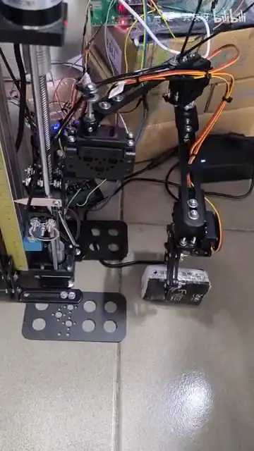
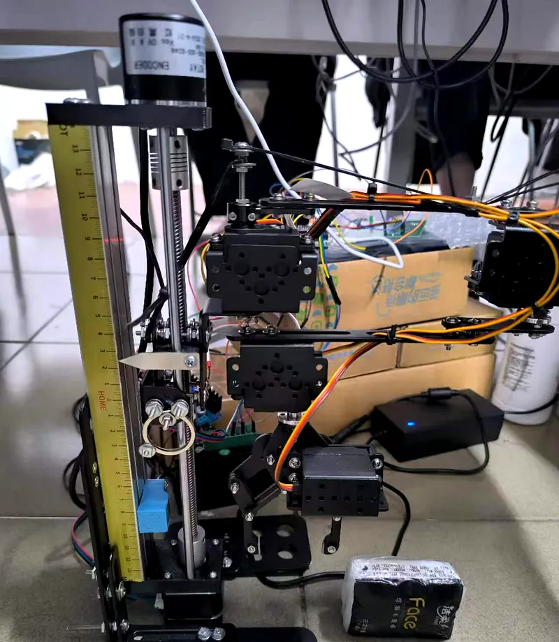
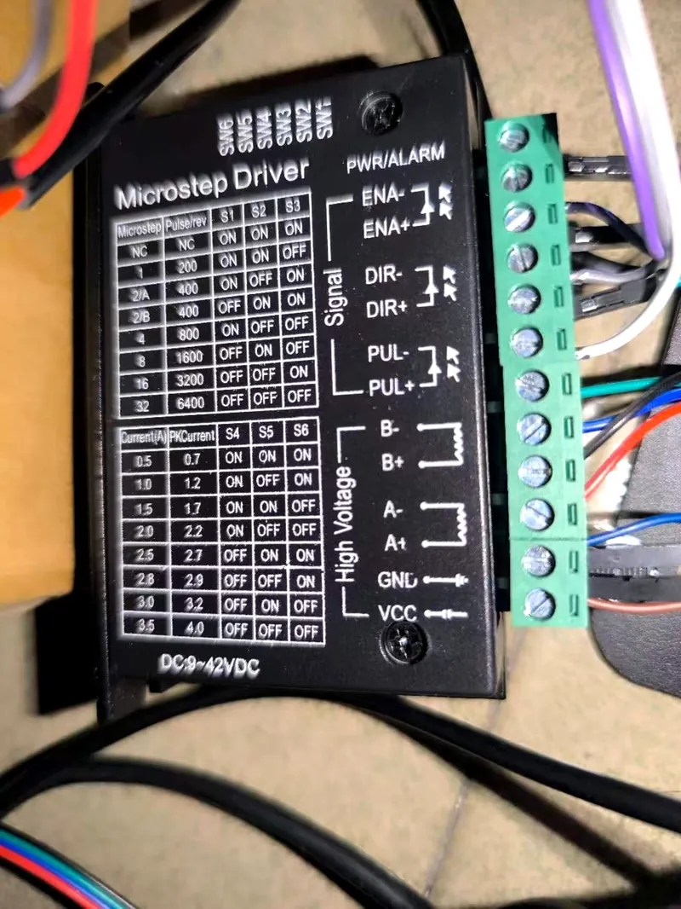
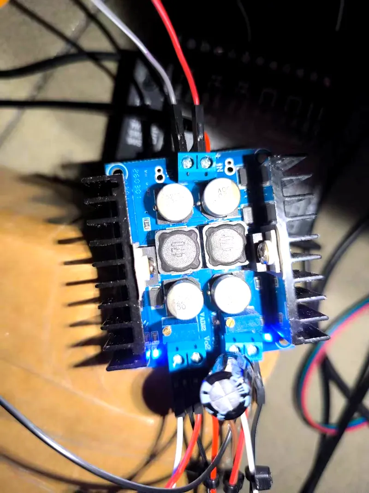
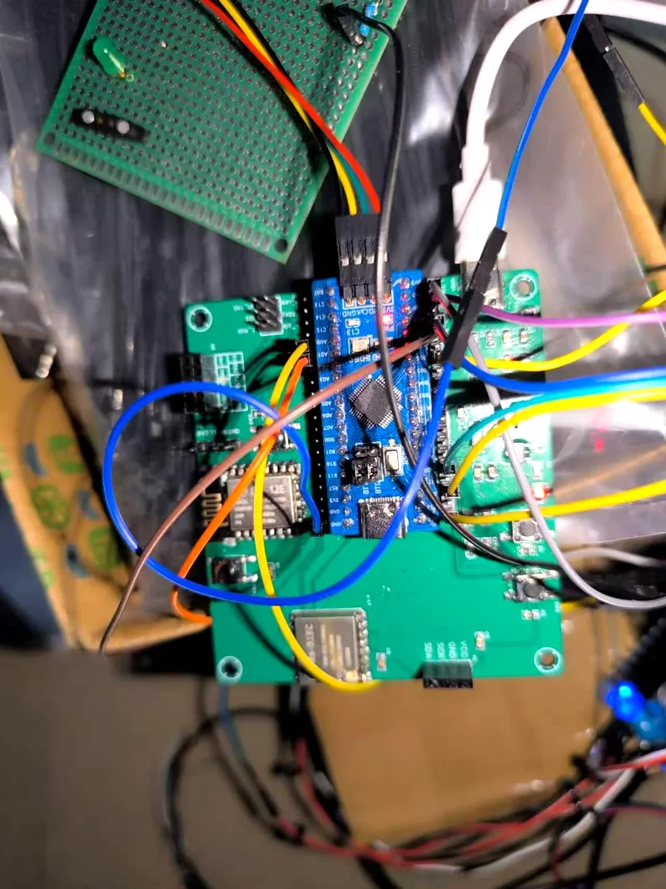
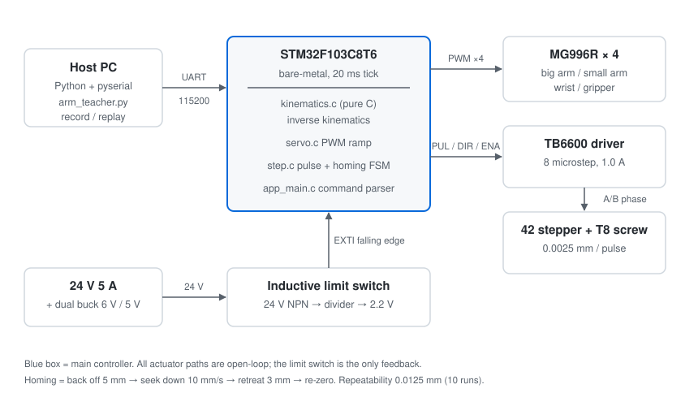

# 立柱式 SCARA 码垛机械臂

一台自制的四轴 SCARA 码垛机械臂：STM32F103 跑平面二连杆逆运动学与实时运动控制，
PC 上位机做示教-复现。**重复定位精度 0.0125mm，搬运落点误差 5mm。**

<p align="center">
  
  
  
  
</p>

---

## 演示



*10 秒循环：伸展 → 落到地面抓取纸巾 → 抬起 → 平移。纸巾是临时替代物，真方块到了会重新标定夹爪安全位。*

📺 完整演示视频（65 秒）：[B 站](https://b23.tv/tC1w0Os) · [仓库内 mp4](assets/demo.mp4)

## 整机与硬件



立柱滑台（T8 丝杆 + 42 步进 + 编码器）、大臂舵机、小臂舵机、腕转舵机、平行夹爪。
黄色卷尺是临时贴的行程标尺，用来量 Z 轴实际可用高度。

| 步进驱动器 | 电源与降压 | 主控接线 |
|---|---|---|
|  |  |  |
| TB6600 类，拨码 `010101` = 8 细分 / 1.0A | 24V 输入，双路降压供电舵机 | STM32F103 核心板 + 限位分压板 |

## 亮点

- **四轴 + 立柱升降**：大臂 / 小臂 / 腕转 / 平行夹爪，臂展 L1=170mm、L2=135mm，工作半径 35～305mm
- **逆解只用余弦定理**：平面二连杆解析解，跳开 DH 参数与雅可比矩阵，135 行纯 C 无 HAL 依赖，可在 PC 上脱离硬件单测
- **回零重复性 0.0125mm**：连续 10 次回零，触发点脉冲极差 5 脉冲（0.0025mm/脉冲）
- **搬运落点误差 5mm**：从 (100,0) 抓取到 (200,0) 放置，含末端下坠的确定性偏差
- **腕转姿态解耦**：推导并四组实测标定「小臂绝对角—腕转角—夹爪朝向」关系，平行爪在任意工作点保持固定朝向
- **整个项目从失败里长出来**：踩过的坑全部量化记录在 [`docs/11-踩坑复盘.md`](docs/11-踩坑复盘.md)，包括一个潜伏一个月的方向 bug

## 规格

| 项目 | 参数 |
|---|---|
| 构型 | SCARA（大臂 / 小臂 / 腕转） + 立柱丝杆升降 + 平行夹爪 |
| 臂长 | L1 = 170mm，L2 = 135mm（实测） |
| 工作半径 | 数学 35～305mm；建议 120～280mm |
| 末端定位 | ±5mm（逆解 + 标定误差） |
| 回零重复性 | 0.0125mm（10 次极差） |
| Z 轴行程 | 实测可用 70mm（软限位默认 60mm） |
| Z 轴分辨率 | 0.0025mm/脉冲（T8 导程 4mm ÷ 1600 脉冲/转） |
| 舵机 | MG996R × 4，50Hz PWM，CCR 直写微秒值（1μs 分辨率） |
| 主控 | STM32F103C8T6，裸机前后台，20ms 控制节拍 |
| 供电 | 24V 5A → 步进驱动器直供；双路降压 6.0V / 5～6V 供舵机 |
| 上位机 | Python + pyserial，115200 8N1 |

## 系统架构



上位机通过串口发坐标，STM32 解逆运动学后同时驱动四路舵机（TIM2/TIM4 硬件 PWM）
和一路步进（TIM1 脉冲 + GPIO 方向）。限位开关是**唯一的闭环反馈**，只用于 Z 轴回零 ——
其余全部开环，这也是为什么标定和重复性验证在这个项目里格外重要。

## 仓库结构

| 目录 | 内容 |
|---|---|
| [`firmware/`](firmware/) | STM32 固件：`User/` 业务代码、`Core/` CubeMX 生成、`Drivers/` HAL 库 |
| [`docs/`](docs/) | 设计文档：选型、运动学、标定、回零、姿态解耦、踩坑复盘 |
| [`tools/`](tools/) | 上位机 `arm_teacher.py`、舵机标定工具、运动学 PC 端测试 |
| [`hardware/`](hardware/) | 接线核对表、上机测试记录、BOM |
| [`assets/`](assets/) | README 用图片与演示视频 |

## 快速开始

**只想看效果** → 看上面的演示，或直接读 [`docs/01-构型与选型.md`](docs/01-构型与选型.md)。

**想复现一台**

1. 按 [`hardware/BOM.md`](hardware/BOM.md) 采购（舵机 ×4、42 步进 + TB6600、T8 丝杆滑台、STM32F103 核心板、24V 5A 电源、电感式限位）
2. 按 [`docs/08-整机接线总表.md`](docs/08-整机接线总表.md) 接线，再用 [`hardware/接线核对表.md`](hardware/接线核对表.md) 逐条打勾
3. 上电前必做静态检查：三点共地、470μF 极性、降压输出 4.8V 以上
4. 按 [`docs/02-舵机标定.md`](docs/02-舵机标定.md) 标定四个舵机的脉宽边界
5. 按 [`docs/04-回零状态机.md`](docs/04-回零状态机.md) 调限位与回零

**想改固件**

```bash
# 用 Keil MDK 打开
firmware/MDK-ARM/Arm.uvprojx

# 或用命令行编译（UV4 需在 PATH 或写全路径）
UV4.exe -j0 -b firmware/MDK-ARM/Arm.uvprojx -o build.log
```

⚠️ 固件依赖 CubeMX 生成的 `Core/` 与 `Drivers/`，**不要手改 `Core/`**——改了下次 Generate 会被冲掉，
要改配置请改 `firmware/Arm.ioc` 后重新生成。

**想测运动学（不需要硬件）**

```bash
cd tools/pc_test
make        # 或直接 gcc kinematics.c test_*.c -o test -lm
./test
```

## 文档

| 文档 | 内容 |
|---|---|
| [01 构型与选型](docs/01-CubeMX配置清单.md) | CubeMX 配置逐项说明 |
| [02 舵机标定](docs/02-舵机标定.md) | 四轴脉宽边界实测流程与数据表 |
| [03 运动学与工作空间](docs/03-运动学与工作空间.md) | 余弦定理逆解推导、工作区实测真相 |
| [04 步进驱动与回零](docs/04-步进驱动与回零.md) | 共阳接法、脉冲方案、回零状态机 |
| [05 串口协议与上位机](docs/05-串口协议与上位机.md) | 13 条命令定义、示教-复现流程 |
| [06 驱动器接线与拨码](docs/06-驱动器接线与拨码.md) | 端子顺序、拨码表、上电检查顺序 |
| [07 舵机是怎么定位的](docs/07-舵机是怎么定位的.md) | 舵机内部闭环原理 |
| [08 整机接线总表](docs/08-整机接线总表.md) | 一根一线的完整接线 |
| [09 核心板引脚对照](docs/09-核心板引脚对照.md) | 40 脚逐条对照 |
| [10 腕转姿态解耦](docs/10-腕转姿态解耦.md) | ★ 平行爪朝向随位置漂移的数学解法 |
| [11 踩坑复盘](docs/11-踩坑复盘.md) | ★ 七个量化记录的坑，含一个潜伏一个月的方向 bug |

## 已知问题

- [ ] 臂满伸（r > 250mm）时整机前倾，需要手扶。根因是 MG996R 径向承载 3～5 kg·cm，而末端弯矩约 14 kg·cm，**超载约 3 倍**。已用垫圈分载、禁止小臂伸到最长、待机收拢缓解，属结构性限制
- [ ] 臂满伸时末端下坠约 30～40mm。确定性可复现，不破坏示教-复现，但影响绝对定位精度
- [ ] 视觉分拣（V2）尚未实现，当前只做到示教-复现
- [ ] 夹爪开口对 40mm 方块的适配尚未实测
- [ ] Z 轴为开环步进，无编码器反馈，丢步无法自检

## 文档与致谢

- 逆解思路：平面二连杆余弦定理，参考《机器人学导论》(Craig) 第 4 章
- 舵机 PWM 与标定方法：MG996R 数据手册
- TB6600 类驱动器接线：厂家规格书

## License

MIT，保留原作者署名即可。欢迎复刻、修改，拿它做了课程作业或毕设的话欢迎在 Issue 里说一声 :)
